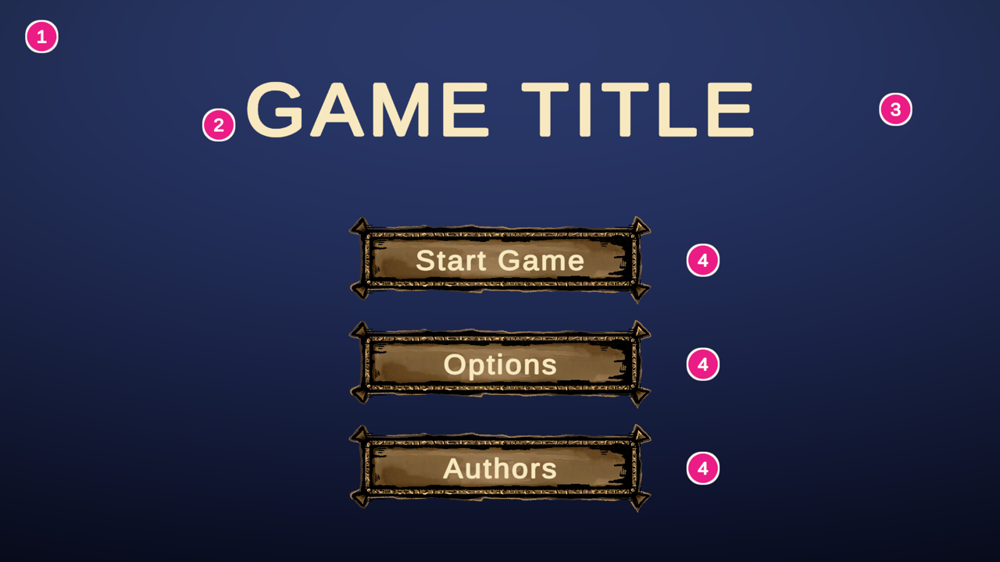
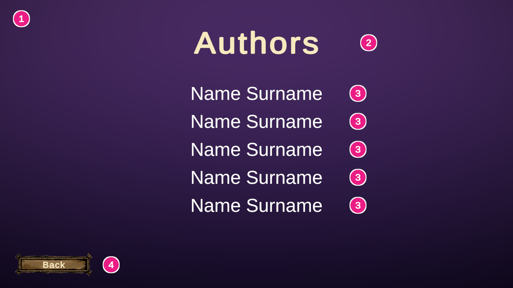
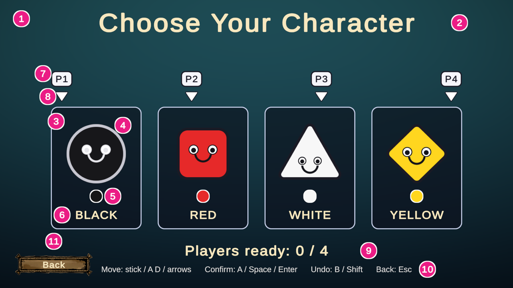
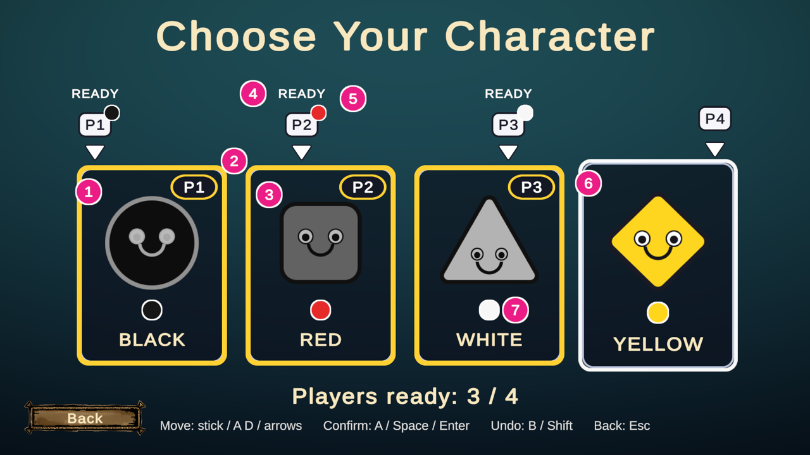
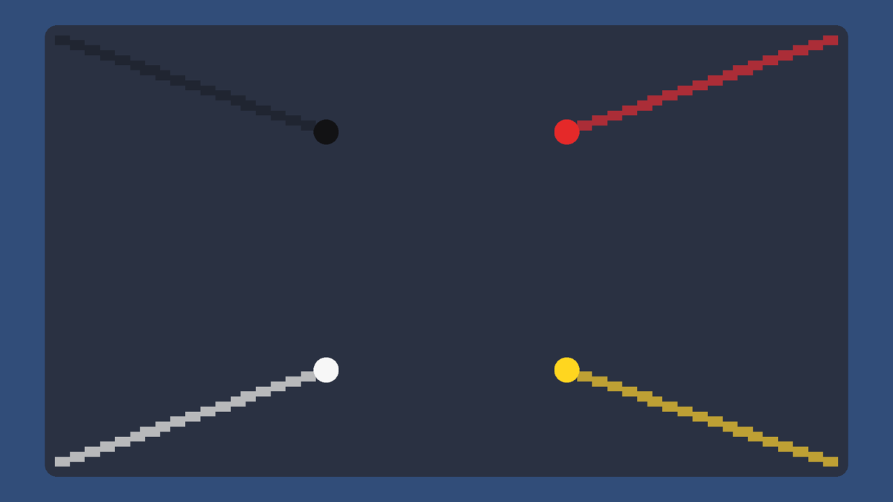

# Artist Guide – Main Menu & Character Selection

This guide is for graphic designers and sound artists. You do **not** need to write or change any code: every picture,
font, colour and sound of the main menu and the character selection is a normal Unity asset that you drag into a
field in the Inspector.

Everything that is in the project right now is **placeholder** art and sound. Replace it piece by piece; the menu
keeps working at every step, even with empty fields.

> **Tip:** in Unity, *Tools → GameJam → Open Artist Guide (Menu and Character Select)* opens this file.

**Contents**

1. [Quick start](#1-quick-start)
2. [Where files go (folders)](#2-where-files-go-folders)
3. [Where each picture is assigned (cheat sheet)](#3-where-each-picture-is-assigned-cheat-sheet)
4. [Main Menu](#4-main-menu)
5. [Authors screen](#5-authors-screen)
6. [Character Selection](#6-character-selection)
7. [Sound effects and music](#7-sound-effects-and-music)
8. [Import settings](#8-import-settings)
9. [Check that it looks right in the game](#9-check-that-it-looks-right-in-the-game)
10. [Troubleshooting](#10-troubleshooting)
11. [What not to break (and how to reset)](#11-what-not-to-break-and-how-to-reset)
12. [Notes for the programmer](#12-notes-for-the-programmer)

---

## 1. Quick start

1. Put your finished PNG files into the folders from [section 2](#2-where-files-go-folders).
2. Open the scene **`Assets/Scenes/MainMenu.unity`** (double-click it in the *Project* window).
3. Drag your sprites into the fields listed in [section 3](#3-where-each-picture-is-assigned-cheat-sheet).
4. Press **Play**. The game always starts in the Main Menu, whichever scene is open.

Two ways to replace a placeholder – use whichever you like:

| Way | How | Good for |
|---|---|---|
| **A. Overwrite the file** | Copy your PNG over the placeholder with **exactly the same file name** (in Finder / Explorer, or by dragging it onto the file in the Project window). Unity keeps every reference, so nothing has to be reassigned. | Quick swaps. Check the [import settings](#8-import-settings) of the new file afterwards. |
| **B. Add a new file and assign it** | Drag your PNG into the right folder, then drag it into the Inspector field (*Source Image*, *Portrait*, …). | When names or sizes change. |

---

## 2. Where files go (folders)

| What | Folder | Placeholder files in it |
|---|---|---|
| Main Menu and Authors pictures (backgrounds, logo, buttons) | `Assets/Art/Menu/` | `MainMenuBackground.png`, `AuthorsBackground.png`, `button_normal.png`, `button_hover.png`, `button_pressed.png`, `button_disabled.png` |
| Character Selection pictures | `Assets/Art/CharacterSelect/` | `CharacterSelectBackground.png`, `Character_1.png` … `Character_4.png`, `Indicator_P1.png` … `Indicator_P4.png`, `NavigationArrow.png`, `SlotFrame.png`, `SlotHighlight.png`, `SlotSelected.png`, `OwnerBadge.png`, `ColorChip.png`, `UIGreyscale.mat` (the grey-out material) |
| Fonts (create the folder if it is missing) | `Assets/Art/Fonts/` | – |
| Sound effects and music | `Assets/Audio/Menu/` | `ButtonHover.wav`, `ButtonClick.wav`, `Back.wav`, `ScreenTransition.wav`, `CharacterMove.wav`, `CharacterConfirm.wav`, `CharacterCancel.wav`, `CharacterUnavailable.wav`, `AllPlayersReady.wav`, `GameStart.wav` |
| The two "settings" assets you edit | `Assets/Config/Menu/` | `CharacterRoster.asset` (characters, their sprites and colours), `MenuAudioSet.asset` (all sounds and the music) |
| Prefabs (reusable pieces) | `Assets/Prefabs/Menu/` | `MenuButton`, `CharacterSlot`, `PlayerCursor`, `MenuPlayerInput` |
| The menu scene | `Assets/Scenes/MainMenu.unity` | – |

---

## 3. Where each picture is assigned (cheat sheet)

In the scene, everything lives under **`MenuCanvas`** in the *Hierarchy*. Click an object, then look at the *Inspector*.

| What you want to change | Click this … | … and set this field |
|---|---|---|
| Main Menu background | Hierarchy: `MenuCanvas ▸ MainMenuScreen ▸ Background` | **Image ▸ Source Image** |
| Authors background | `MenuCanvas ▸ AuthorsScreen ▸ Background` | **Image ▸ Source Image** |
| Character Selection background | `MenuCanvas ▸ CharacterSelectScreen ▸ Background` | **Image ▸ Source Image** |
| Game logo (optional) | `MainMenuScreen ▸ Logo` (switched **off** – tick the box at the top of the Inspector to show it) | **Image ▸ Source Image** |
| Extra decorative pictures | `…Screen ▸ Decorations` (an empty holder) | add child *UI ▸ Image* objects; they appear above the background |
| Button picture, normal | Project: `Assets/Prefabs/Menu/MenuButton` (all buttons) **or** one button in the Hierarchy | **Image ▸ Source Image** |
| Button picture, hover / pressed / keyboard-selected / disabled | the same object | **Button ▸ Sprite Swap ▸** *Highlighted Sprite* / *Pressed Sprite* / *Selected Sprite* / *Disabled Sprite* |
| Button text, font, text colour | the button's child **`Label`** | **TextMeshPro ▸** *Text Input*, *Font Asset*, *Font Size*, *Vertex Color* |
| Button position and size | the button | **Rect Transform ▸** *Pos X / Pos Y*, *Width / Height* |
| The 4 character sprites | Project: `Assets/Config/Menu/CharacterRoster` | **Characters ▸ Element 0 … 3 ▸ Portrait** |
| A hand-drawn "taken" version of a character | `CharacterRoster` | **Characters ▸ Element N ▸ Unavailable Portrait** |
| Which character has which colour | `CharacterRoster` | **Characters ▸ Element N ▸ Color** (dropdown) |
| The exact RGB of Black / Red / White / Yellow | `CharacterRoster` | **Palette** fields *Black, Red, White, Yellow* (at the top) |
| Character names | `CharacterRoster` | **Characters ▸ Element N ▸ Display Name** |
| Strength of the grey-out | Project: `Assets/Art/CharacterSelect/UIGreyscale` | *Grey Amount*, *Darken* |
| P1 / P2 / P3 / P4 indicator pictures | Hierarchy: `CharacterSelectScreen ▸ PlayerIndicators ▸ PlayerIndicator_P1` (… `_P4`) `▸ Badge` | **Image ▸ Source Image** |
| The text on an indicator ("P1") | `PlayerIndicator_P1 ▸ Badge ▸ Label` | **Text Input** (empty it if your picture already shows the text) |
| Navigation arrow | Project: `Assets/Prefabs/Menu/PlayerCursor ▸ Arrow` | **Image ▸ Source Image** |
| READY marker | `PlayerCursor ▸ ReadyMarker` | change its text, or replace it with an Image |
| Colour chip on a ready indicator | `PlayerCursor ▸ ColorChip` | **Image ▸ Source Image** |
| Character card (frame) | Project: `Assets/Prefabs/Menu/CharacterSlot ▸ Frame` | **Image ▸ Source Image** (*Image Type: Sliced*) |
| Hover highlight of a card | `CharacterSlot ▸ Highlight` | **Image ▸ Source Image** |
| "Selected character" frame | `CharacterSlot ▸ SelectedFrame` | **Image ▸ Source Image** |
| Tag that shows who took a character | `CharacterSlot ▸ OwnerBadge` | **Image ▸ Source Image** |
| Colour swatch under a character | `CharacterSlot ▸ ColorSwatch` | **Image ▸ Source Image** |
| All sound effects | Project: `Assets/Config/Menu/MenuAudioSet` | the **Clip** of each entry |
| Background music | `MenuAudioSet` | **Menu Music** |

---

## 4. Main Menu

| # | What | Object in the Hierarchy (`MenuCanvas ▸ MainMenuScreen ▸ …`) |
|---|---|---|
| 1 | Background | `Background` |
| 2 | Logo (hidden until you switch it on) | `Logo` |
| 3 | Title text | `Title` |
| 4 | The three buttons: Start Game, Options, Authors | `StartGameButton`, `OptionsButton`, `AuthorsButton` |

### 4.1 Replace the background

1. In the Hierarchy select `MenuCanvas ▸ MainMenuScreen ▸ Background`.
2. In the Inspector, drag your sprite into **Image ▸ Source Image**.
3. Your picture is scaled to **cover the whole screen without being stretched**, whatever the window shape; the edges
   are cropped on screens that are wider or taller than your art. Make 16:9 art (e.g. 1920 × 1080 or 3840 × 2160) and
   keep important things away from the very edges. If your art is **not** 16:9, type its width ÷ height into
   **Aspect Ratio Fitter ▸ Aspect Ratio** (16:9 = 1.7778).

(Or overwrite `Assets/Art/Menu/MainMenuBackground.png` – see [Quick start](#1-quick-start).)

### 4.2 Logo, title and decorations

* **Title**: `Title` is a text object (*TextMeshPro*). Change *Text Input*, *Font Asset*, *Font Size*, *Vertex Color*. To use a
  picture instead, switch the text off (checkbox at the top of the Inspector).
* **Logo**: select `Logo`, tick the checkbox at the top of the Inspector to switch it on, drag your logo into
  **Image ▸ Source Image**, then move/resize it with the **Rect Transform** (or press **T** and drag it in the Scene view).
* **More decorations**: right-click `Decorations` ▸ *UI ▸ Image*, drag a sprite into *Source Image*, place it. Pictures in
  `Decorations` are drawn above the background and below the buttons.

### 4.3 Replace the three button graphics and their states

The three buttons (and the two *Back* buttons) are copies of one prefab, **`Assets/Prefabs/Menu/MenuButton`**.

* **Change all buttons at once** – double-click `MenuButton` in the Project window (it opens in *Prefab Mode*) and edit the
  root object. Leave Prefab Mode with the **◀** arrow at the top left of the Hierarchy.
* **Change one button only** – select it in the Hierarchy (e.g. `StartGameButton`) and edit it there. Changed values are
  shown in **bold** with a blue bar: that is an *override* for that one button.

On the button object:

| State | When it is shown | Field |
|---|---|---|
| **Normal** | the button just sits there | **Image ▸ Source Image** |
| **Highlighted** | the mouse is over it | **Button ▸ Highlighted Sprite** |
| **Pressed** | the button is being pressed | **Button ▸ Pressed Sprite** |
| **Selected** | highlighted with the keyboard / controller (stays until you move away) | **Button ▸ Selected Sprite** |
| **Disabled** | only if *Interactable* is switched off | **Button ▸ Disabled Sprite** |

*Transition* on the Button is already **Sprite Swap**. To look at the disabled picture, untick **Interactable** for a
moment (and tick it again afterwards!).

> The **Options** button is a normal, visible button on purpose; pressing it does nothing yet. Do not switch off
> *Interactable* on it unless you want it to look disabled.

**Size and position** – select the button and use **Rect Transform**: *Pos X*, *Pos Y*, *Width*, *Height* (or the Rect
tool, **T**). The painted placeholder buttons are 584 × 172. If your new button has other proportions, set *Width* and
*Height* in the same proportion, or press **Set Native Size** on the *Image*. All three states must have the same size.

**Text, font, colour** – open the button (click the small arrow in the Hierarchy) and select its child **`Label`**:

* *Text Input* – the words on the button.
* *Font Asset* – your font (see [Fonts](#fonts)).
* *Font Size*, *Vertex Color* (text colour), *Alignment*.

### Fonts

1. Put your `.ttf` / `.otf` into `Assets/Art/Fonts/`.
2. *Window ▸ TextMeshPro ▸ Font Asset Creator*, pick the font, choose a character set that contains **all letters you
   use** (for example *Extended ASCII*, or *Custom Characters* for other languages), click **Generate Font Atlas**, then
   **Save**.
3. Drag the new font asset into **Font Asset** of every text you want to change (or only once, in the prefab).

---

## 5. Authors screen

| # | What | Object (`MenuCanvas ▸ AuthorsScreen ▸ …`) |
|---|---|---|
| 1 | Background | `Background` (same as the Main Menu: **Image ▸ Source Image**) |
| 2 | Title | `Title` |
| 3 | The five names | `Author_1` … `Author_5` – type the real names into **TextMeshPro ▸ Text Input** |
| 4 | Back button | `BackButton` – same button prefab as the Main Menu (graphics, text, position as in [4.3](#43-replace-the-three-button-graphics-and-their-states)) |

You can move, resize, recolour or re-font each name on its own. *Esc* (keyboard) or the *Select/Back* button of a
controller also leaves the Authors screen.

---

## 6. Character Selection

All four players pick a character at the same time, each with their own controller. A character that is taken gets
greyed out and nobody else can choose it. When every player has confirmed, the game starts by itself.

| # | What | Object (`MenuCanvas ▸ CharacterSelectScreen ▸ …`) |
|---|---|---|
| 1 | Background | `Background` |
| 2 | Title text | `Title` |
| 3 | Character card (frame) | `Slots ▸ CharacterSlot_1 ▸ Frame` |
| 4 | The character picture | `Slots ▸ CharacterSlot_1 ▸ Portrait` – *comes from the roster, see 6.1* |
| 5 | Colour swatch (the colour this character gives) | `CharacterSlot_1 ▸ ColorSwatch` |
| 6 | Character name | `CharacterSlot_1 ▸ NameLabel` |
| 7 | Player indicator (the P1 … P4 badge) | `PlayerIndicators ▸ PlayerIndicator_P1 ▸ Badge` |
| 8 | Navigation arrow (points at the character the player is on) | `PlayerIndicator_P1 ▸ Arrow` |
| 9 | Status text ("Players ready: 0 / 4") | `StatusLabel` |
| 10 | Controls hint | `ControlsHint` |
| 11 | Back button | `BackButton` |

What the player sees while playing the selection:

| # | What it means | Where you restyle it |
|---|---|---|
| 1 | **Selected-character frame** – this character has been taken | `CharacterSlot ▸ SelectedFrame` |
| 2 | **Owner tag** – who took it (P1 … P4) | `CharacterSlot ▸ OwnerBadge` (+ its `Label`) |
| 3 | **Greyed-out picture** – the character is unavailable to the others | [6.3](#63-the-greyed-out-look) |
| 4 | **READY marker** on the player's indicator | `PlayerCursor ▸ ReadyMarker` |
| 5 | **Colour chip** – the colour the player got | `PlayerCursor ▸ ColorChip` |
| 6 | **Hover highlight** – a player is on this character | `CharacterSlot ▸ Highlight` |
| 7 | Colour swatch of each character (always visible) | `CharacterSlot ▸ ColorSwatch` |

### 6.1 The four character sprites

All data about the four characters is in **one asset**: `Assets/Config/Menu/CharacterRoster`.

1. Select it in the Project window.
2. Open **Characters** and its **Element 0 … Element 3** (left to right on screen).
3. Drag your sprite into **Portrait**. Any size or proportion works – the picture is fitted into the card without being
   stretched (about 512 × 512 with a transparent background is a good size).
4. Optional: **Display Name** (empty = it shows the colour name, e.g. RED).

You see the new picture **immediately** in the Scene/Game view when the `CharacterSelectScreen` object is switched on in the
Hierarchy (tick its checkbox) – no need to press Play.

### 6.2 The four player colours

The four colours are **Black, Red, White, Yellow**. The colour of a character is the colour of **everything that player
owns in the game**: the character on the map, its trail and the territory it captures (and its labels on the results
screen). To change it you edit the roster – nothing else:

* **Which character has which colour:** `CharacterRoster ▸ Characters ▸ Element N ▸ Color` is a dropdown with the four
  colours. To swap Red and White, just swap the two dropdowns. The swatch and the name on the card follow at once.
* **The exact shade:** at the top of the roster, the **Palette** fields *Black*, *Red*, *White*, *Yellow* hold the real
  RGB values. Change one and it changes everywhere (cards, characters, trails, territory).
* Give each character a **different** colour. If two characters share a colour, Unity shows a warning in the Console and
  their players would look identical in the game.

> **Black needs care.** Pure black draws very dark territory and trails; on the current dark map background they are
> hard to see (look at the picture above). If that bothers you, make the *Black* palette entry a little lighter, or
> make the map background lighter (`Assets/Config/MapConfig` ▸ *Background Tint*).

### 6.3 The greyed-out look

When another player takes a character, its picture fades to grey. There are three ways to control this; they can be
combined:

1. **Automatic grey-out (default).** The picture goes through the material `Assets/Art/CharacterSelect/UIGreyscale`.
   Select the material and change **Grey Amount** (0 = original colours, 1 = completely grey) and **Darken** (how much
   darker it gets). You do not have to make any extra pictures.
2. **Tint.** On the `CharacterSlot` prefab, component **Character Slot View**: *Available Color* and *Unavailable Color*
   (multiplied with the picture), and *Grey Transition Seconds* (how fast it fades).
3. **Your own drawing.** Put a hand-drawn greyed-out version into
   `CharacterRoster ▸ Characters ▸ Element N ▸ Unavailable Portrait`. It is then shown **instead of** the automatic
   grey-out for that character.

The grey-out is only visible while playing (it happens when a player confirms), not in the Scene view.

### 6.4 Player indicators (P1 – P4), arrows and READY

Each player has an indicator that glides over the characters. It is one prefab,
**`Assets/Prefabs/Menu/PlayerCursor`**, used four times in the scene as `PlayerIndicator_P1 … _P4`.

* **The P1 … P4 pictures** – every player has their own: select `PlayerIndicator_P2 ▸ Badge`, drag the picture into
  **Image ▸ Source Image**. The badge picture is never tinted, so full-colour art stays as you drew it. The text "P2" is
  the child `Label` (empty it, or switch it off, if your picture already contains the text).
* **The navigation arrow** – open the prefab `PlayerCursor`, select `Arrow`, change **Image ▸ Source Image**. The arrow's
  *tip* (bottom centre) is the point of the indicator, so draw the arrow pointing **down** and keep its tip at the bottom.
  It bobs up and down while the player is choosing.
* **READY marker and colour chip** – appear on the indicator once the player has confirmed. `ReadyMarker` holds a text; you
  can replace it with a picture. `ColorChip` is tinted with the player's colour automatically.
* **Waiting for a controller** – if a player's controller is not connected yet, the indicator is dimmed
  (*Player Cursor View ▸ Waiting Tint*) and the status text says who is missing.
* **Motion** – *Player Cursor View ▸ Follow Speed*, *Bob Height*, *Bob Speed*.
* **Where the indicators hover** – the little object `CursorAnchor` inside the `CharacterSlot` prefab. Move it up or down
  to change the height of all indicators above the cards. The horizontal gap between players standing on the same
  character is **Cursor Spacing** on `CharacterSelectScreen`.

### 6.5 Cards, frames and other UI pieces

Open the prefab **`Assets/Prefabs/Menu/CharacterSlot`** to restyle all four cards at once. Its pieces (top to bottom in the
Hierarchy = back to front):

| Piece | What it is |
|---|---|
| `Frame` | the card background (a *9-sliced* sprite, so it scales cleanly) |
| `Portrait` | the character picture (filled in from the roster – do not assign it here) |
| `ColorSwatch` | the colour dot (tinted automatically) |
| `NameLabel` | the character name (text) |
| `Highlight` | shown while a player stands on the card |
| `SelectedFrame` | shown once the character is taken |
| `OwnerBadge` | the "P1 … P4" tag of the owner, shown once taken |
| `CursorAnchor` | invisible; the point where indicators hover |

For `Frame`, `Highlight`, `SelectedFrame` and `OwnerBadge`, the Image is set to **Image Type: Sliced**. When you make
new art for them, open the sprite in the **Sprite Editor** (button in the Inspector) and drag the green lines to set the
**Borders** so that the corners stay unscaled. To see the card with its different states, switch `Highlight`,
`SelectedFrame` and `OwnerBadge` on and off in the Hierarchy while the prefab is open.

The **status text**, the **controls hint** and the **title** are plain *TextMeshPro* objects: edit their text, font and colour
directly. The text of the status line can be changed on `CharacterSelectScreen ▸ Character Select Screen ▸ Status Format`
(`{0}` = players ready, `{1}` = players taking part).

---

## 7. Sound effects and music

**Every sound lives in one asset: `Assets/Config/Menu/MenuAudioSet`.** Select it and drag an audio clip into the **Clip**
slot of an entry. Each entry also has its own **Volume**; **Effects Volume** at the bottom scales all effects.
An empty slot is silent – nothing breaks.

| Entry in the asset | Plays when … |
|---|---|
| **Button Hover** | the mouse moves over a menu button, or the keyboard/controller moves the highlight onto it |
| **Button Click** | a menu button is pressed (Start Game, Options, Authors) |
| **Back** | a *Back* button is pressed, or Esc is used to go back |
| **Screen Transition** | the menu changes from one screen to another |
| **Character Move** | a player moves to another character |
| **Character Confirm** | a player confirms a character |
| **Character Cancel** | a player takes their character back |
| **Character Unavailable** | a player tries to take a taken character, or the character they were looking at was just taken by someone else |
| **All Players Ready** | the last player confirms (it replaces *Character Confirm* that time) |
| **Game Start** | the menu hands over to the game |
| **Menu Music** | plays in a loop in the menu and fades out when the game starts (leave empty for no music) |

Notes:

* Which sound a *single* button uses can be changed on the button: component **Menu Button Feedback ▸ Hover Sound / Click Sound**
  (the *Back* buttons already use *Back*).
* The sounds are played by the object **`MenuAudio`** in the scene (it needs the `Main Camera`'s *Audio Listener* to be heard).
* Keep effects **short** (under about one second), at a sensible level (peak around −3 dB), and mono is fine.
* The files in `Assets/Audio/Menu/` are simple synthesized placeholders. Replace them by overwriting the file with the same
  name, or assign new clips in the asset.

---

## 8. Import settings

Select a PNG in the Project window and check the Inspector. The placeholders already use these settings.

### Sprites (all menu pictures)

| Setting | Value | Why |
|---|---|---|
| **Texture Type** | **Sprite (2D and UI)** | required to use it in a UI *Image* |
| **Sprite Mode** | **Single** | one picture per file (see the warning below for the button files) |
| **Pixels Per Unit** | **100** | keeps *Set Native Size* equal to the pixel size |
| **Mesh Type** | **Full Rect** | UI sprites are plain rectangles |
| **Generate Mip Maps** | **off** | UI is drawn at a fixed size; mip maps only blur it |
| **Filter Mode** | **Bilinear** (smooth art) or **Point (no filter)** (pixel art) | |
| **Wrap Mode** | **Clamp** | no edge bleeding |
| **Alpha Source / Alpha Is Transparency** | *Input Texture Alpha*, **on** | clean transparent edges |
| **Compression** | **High Quality**; **None** for painted/gradient backgrounds | stops colour banding |
| **Max Size** | at least the size of your picture (the default is 2048; use **4096** for 4K backgrounds) | otherwise Unity shrinks it |
| **Read/Write** | **off** | saves memory |
| **sRGB (Color Texture)** | **on** | normal colour pictures |

Recommended sizes: backgrounds **1920 × 1080** (16:9; or 3840 × 2160), buttons **584 × 172** per state (cut tight to the
visible artwork, all states the same size), character portraits about **512 × 512** with a transparent background,
P-indicators about **160 × 120**, arrow about **96 × 96**, 9-sliced frames about **128 × 128**.

> **Warning about the three painted button files** (`button_normal`, `button_hover`, `button_pressed`): they are
> currently cut out of a larger canvas using *Sprite Mode: Multiple* with a fixed rectangle. If you replace such a file
> with a picture of **another size**, select it and set **Sprite Mode = Single**, then click **Apply** – otherwise only part
> of your picture is shown. Better still: export the buttons cut tight (no empty border), as described above.

For 9-sliced pictures also set the **Borders** in the **Sprite Editor** (see [6.5](#65-cards-frames-and-other-ui-pieces)).

### Audio

| Setting | Short sounds (effects) | Music |
|---|---|---|
| Format | WAV (44.1 kHz, 16 bit) or OGG | OGG or WAV |
| **Force To Mono** | on | off |
| **Load Type** | **Decompress On Load** | **Streaming** |
| **Compression Format** | **PCM** (tiny files) or *Vorbis* | **Vorbis** (quality about 70 %) |
| **Preload Audio Data** | on | – |

---

## 9. Check that it looks right in the game

1. Open **`Assets/Scenes/MainMenu.unity`** and make the **Game** view 16:9 (the dropdown at the top left of the Game view,
   e.g. *Full HD (1920 × 1080)*). Also try a few other shapes (*16:10*, *4:3*, *21:9*) to see how backgrounds are cropped.
2. Press **Play**. The game always starts in the Main Menu, even if another scene is open. *(This is the menu item
   Tools ▸ GameJam ▸ Always Play From Main Menu; it has a tick when it is on.)*
3. Go through this checklist:

| Check | What you should see / hear |
|---|---|
| Main Menu | your background, title/logo, three buttons with your graphics and text |
| Move the mouse over a button | the *Highlighted* picture and the hover sound |
| Use the **keyboard arrows** or a controller stick on the menu | the *Selected* picture moves between the buttons |
| Hold the mouse button on a button | the *Pressed* picture |
| **Options** | does nothing (on purpose) |
| **Authors** | five names, then **Back** (or Esc) returns |
| **Start Game** | the Character Selection fades in with the four cards, the P-indicators with their arrows, the status text |
| Move a player left/right | their indicator glides to the next character, the move sound plays |
| Confirm a character | its card gets the selected frame, the owner tag and the grey picture; the player's indicator shows READY and the colour chip |
| Try to move onto a taken character | it is skipped (nobody can stand on it) |
| *Undo* (Cancel) | the card becomes normal again |
| The last player confirms | "All players ready!", then the game starts with every player in the colour of their character |

**Test controls.** The project currently has **Keyboard Test Mode** on (*Tools ▸ GameJam ▸ Keyboard Test Mode*). Then only
**two** players take part and both use one keyboard:

| | Player 1 | Player 2 |
|---|---|---|
| Move | **A** / **D** | **←** / **→** |
| Confirm | **Space** | **Enter** |
| Undo (give the character back) | **Left Shift** | **Right Shift** |

Gamepad players use the **left stick or D-pad**, **A** (confirm) and **B** (undo). **Esc** (or the controller's Select
button) goes back to the Main Menu. In Keyboard Test Mode the game starts when *both* players have confirmed – to look at
a screen for longer, let only one player confirm. To try all four players, switch the test mode off and connect three
gamepads.

**Without pressing Play.** Switch on the `CharacterSelectScreen` object (checkbox in the Inspector) to see the cards with
the sprites, names and colours of the roster, and to move things around. Anything that needs players (grey-out, READY,
colour chips, sounds) shows only in Play mode. You do not have to switch the screens off again before pressing Play – the
menu always starts on the Main Menu.

---

## 10. Troubleshooting

| Problem | Cause and fix |
|---|---|
| A white box instead of my picture | the *Source Image* (or the roster *Portrait*) is empty, or the file is not imported as a **Sprite** (see [section 8](#8-import-settings)) |
| A button shows only part of my picture, or in the wrong place | the file is still *Sprite Mode: Multiple* with an old rectangle – set **Single** and **Apply** |
| The picture is blurry | *Max Size* is smaller than the picture, *Compression* is too strong, or *Filter Mode* is wrong |
| Gradients show stripes | set **Compression: High Quality** or **None** |
| Text shows empty squares | the font asset does not contain those letters – generate it again with the right character set |
| Characters are not greyed out | *Character Slot View ▸ Unavailable Material* is empty (re-assign `UIGreyscale`), or the character has its own *Unavailable Portrait* |
| Everything is pink | a shader or material is missing – re-assign `UIGreyscale` on the `CharacterSlot` prefab |
| No sound | the *Clip* is empty, its *Volume* is 0, or the scene has no *Audio Listener* (it is on the `Main Camera`) |
| I changed a prefab but one object did not follow | that object has its own override (shown **bold**); right-click the field ▸ **Revert** |
| Two players look the same in the game | two characters have the same *Color* in the roster – change one |
| The menu does not react to the controller | click the Game view once so it has focus; check the controller is connected |
| I broke the scene | see the next section |

---

## 11. What not to break (and how to reset)

You can freely **restyle, move, resize, recolour and re-font** every object. Pictures, fonts and sounds can never break the
menu. Only these things must stay:

* **Do not delete or rename** (and do not clear the fields that point to them): `MenuFlow`, `MenuAudio`, `EventSystem`,
  `Main Camera`, the three screens, `StartGameButton`, `OptionsButton`, `AuthorsButton`, the two `BackButton`s,
  `CharacterSlot_1 … 4`, `PlayerIndicator_P1 … P4`, `StatusLabel` and `ScreenFader`.
* The roster must keep **exactly four** characters.
* If you want a button to look different, change its pictures – do not replace the button object with a new one.

**Reset.** *Tools ▸ GameJam ▸ Rebuild Main Menu Scene (discards changes to it)* builds a fresh scene. Your sprites, prefabs,
roster and audio set are kept. *Tools ▸ GameJam ▸ Setup Main Menu* only creates what is missing and never overwrites
your files.

---

## 12. Notes for the programmer

* **Flow.** Build Settings: scene 0 = `MainMenu`, scene 1 = `Main` (the game). In the Editor, *Play* always starts on the
  menu (*Tools ▸ GameJam ▸ Always Play From Main Menu*). Untick it to press Play directly on the game scene; then
  the colours come from the Players Config slots, as before the menu existed.
* **Scripts** (`Assets/Scripts/Menu/`): `MenuFlow` (screens, fades, loads the game scene named in *Game Scene Name*),
  `CharacterSelectScreen` (inputs, views), `CharacterSelectModel` (the rules – plain C#, no Unity), `CharacterRoster` and
  `MenuAudioSet` (the two data assets), `GameSession` (hand-over to the game), the `…View` classes (pure visuals).
  Gameplay reads the colour through `PlayersConfig.GetPlayerColor(index)`.
* **Uniqueness.** A character is claimed in one place (`CharacterSelectModel.TryConfirm`); players are processed one after
  another, so two players can never own the same character, even when they confirm in the same frame (the lower player
  number wins a tie; the other is refused and moved to a free character).
* **Controls** are the **`Menu`** action map in `Assets/Input/PlayerControls.inputactions` (*Navigate*, *Confirm*,
  *Cancel*), bound per control scheme (*Gamepad*, *Keyboard*, *KeyboardArrows*). Rebind them there; the action names are
  also fields on `CharacterSelectScreen`. Devices are paired exactly as the game does it (`PlayerDevices`), so each player
  keeps their device from the menu into the game.
* **Options button**: `MenuFlow ▸ On Options Pressed` is an empty UnityEvent – hook the future options screen there.
* **Keyboard Test Mode** is respected: only the players of that mode take part in the selection.
